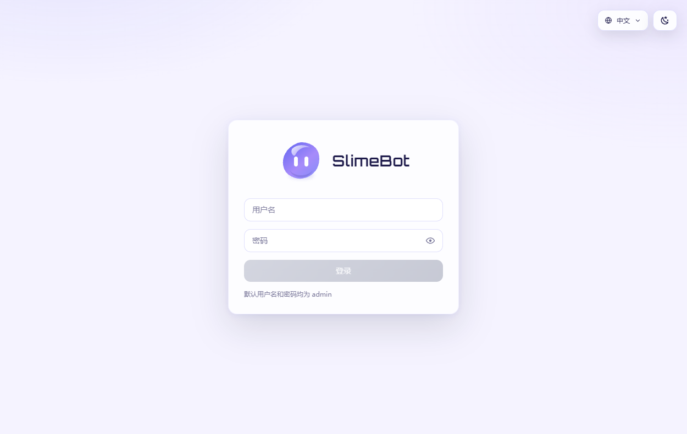
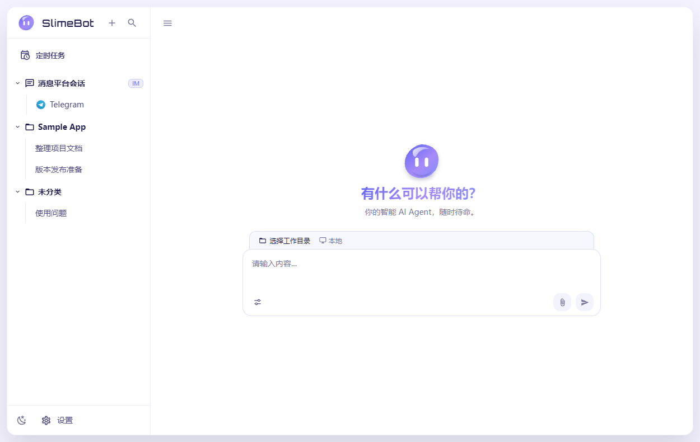
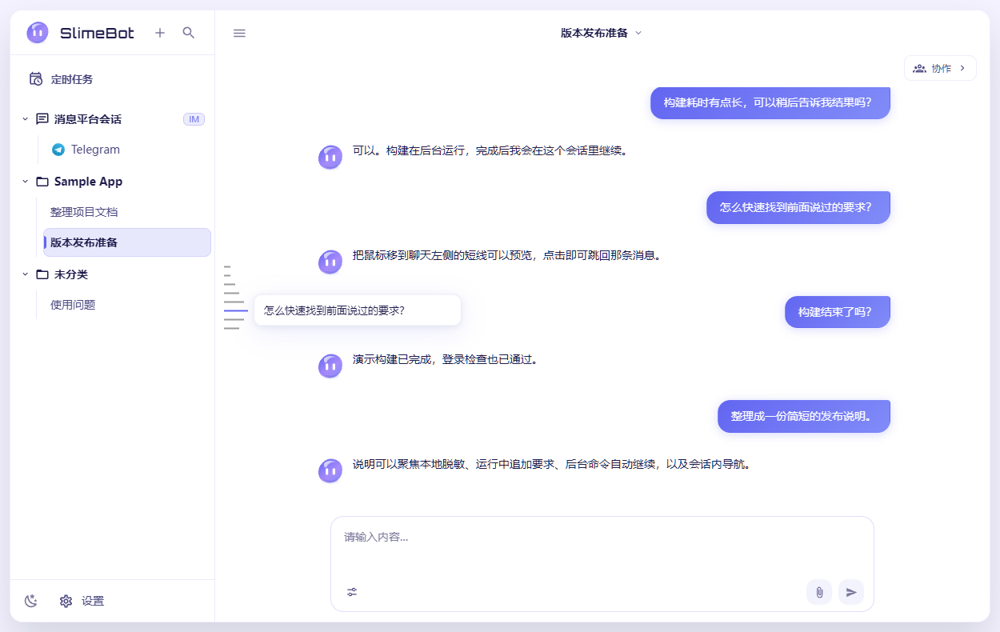
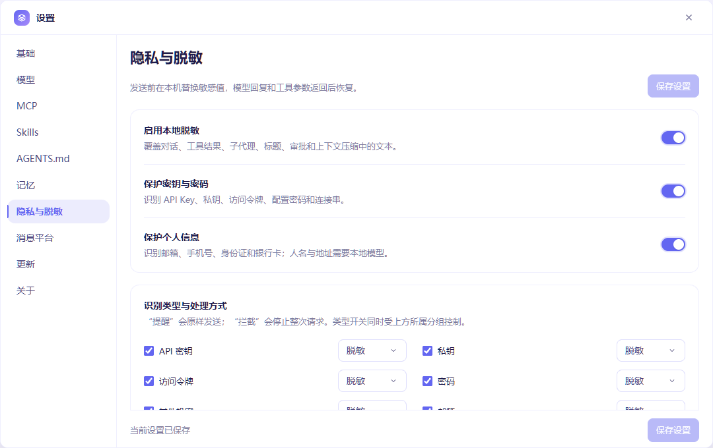

<p align="center">
  
  <br /><br />
  <a href="README.md">简体中文</a> | <strong>English</strong>
</p>

# SlimeBot

A personal AI agent demo: an extensible foundation for conversational AI apps. It ships with a **Go** backend, a **Vue 3** web UI, and a **React + Ink** terminal CLI.

## Features

- Chat sessions, real-time streaming replies, multimodal messages, and automatic title generation. Jump to earlier messages from the Web and desktop conversation navigator.
- **Steer a running task.** Send a follow-up while the agent is responding to guide its next step.
- **Resume after background commands finish.** Long commands can run in the background and continue the same conversation when they finish. [How it works](AGENT-FLOW.md)
- Agent tool-call flows with approval modes, sandbox policies, command/file tools, web requests, web search, and task tracking
- Desktop Computer Use on macOS, Windows, and Linux: let SlimeBot view and interact with apps on your computer, with approval for sensitive actions
- Plan mode, streamed thinking, context compression, MCP configuration, skills, and AGENTS.md instructions
- **Mask sensitive data locally.** Replace credentials and personal information before sending them to the model. Mappings stay in memory by default and expire after 24 hours of inactivity. For encrypted persistence, set `SLIMEBOT_PRIVACY_MAPPING_KEY` (32 random bytes, Base64-encoded) in the server process environment, restart, and enable encrypted storage in Privacy & masking. Store the key separately. The chat menu can clear a chat’s mappings without deleting its messages.
- **File checkpoints.** Open the chat menu in a Web or desktop conversation with a working directory to inspect file diffs, undo one turn, or reverse recorded changes after a checkpoint. The last 20 entries are kept in local storage. Git history and the index are untouched. Ignored untracked files, common credential files, symlinks, and files over 4 MiB are excluded. Conflicting changes block rollback.
- Web UI, CLI TUI, and Telegram integration
- Web sessions grouped by working directory, with a directory picker before the first message; existing sessions without a directory appear under Uncategorized. Messaging sessions are grouped by platform.

## Desktop App

Download the macOS or Windows app from the [latest release](https://github.com/natsuz0ra/SlimeBot/releases/latest). Open the app to start chatting without signing in. Closing the window keeps it running in the background; use the tray menu to quit. On Windows, you can choose whether to create a desktop shortcut during installation.

If the desktop app and Web service use the same data, run only one at a time to avoid duplicate messages and scheduled tasks.

## Install From Release

Install the latest Release with one command:

macOS / Linux:

```bash
curl -fsSL https://github.com/natsuz0ra/SlimeBot/releases/latest/download/install.sh | sh
```

Windows PowerShell:

```powershell
irm https://github.com/natsuz0ra/SlimeBot/releases/latest/download/install.ps1 | iex
```

You can also download the archive for your system from the project releases, extract it, then run `./install.sh` or `.\install.ps1` from the extracted directory.

The installer downloads the matching package when needed, places SlimeBot under a user-local directory, and creates command shims. If your shell cannot find `slimebot`, add the shim directory printed by the installer to `PATH`.

Before running the Web service, edit `~/.slimebot/config.cfg` and set a strong `JWT_SECRET`.

## Update

SlimeBot can check GitHub Releases and apply updates from the installed command:

```bash
slimebot update --check          # check latest stable Release
slimebot update                  # update to latest stable Release
slimebot update --version v1.26.3
```

The update source follows the installer: `SLIMEBOT_REPO` first, otherwise `natsuz0ra/SlimeBot`. Web users can open **Settings -> About** for the update center, and CLI TUI users can run `/update`.

If the running build is `dev`, empty, or cannot be parsed as a version, automatic latest updates are disabled by default. Use `slimebot update --version vX.Y.Z` when you intentionally want to install a specific Release.

## Uninstall

Run the uninstaller from the latest Release with one command, or run it from the extracted Release directory or installed copy.

macOS / Linux:

```bash
curl -fsSL https://github.com/natsuz0ra/SlimeBot/releases/latest/download/uninstall.sh | sh
./uninstall.sh
```

Windows PowerShell:

```powershell
irm https://github.com/natsuz0ra/SlimeBot/releases/latest/download/uninstall.ps1 | iex
.\uninstall.ps1
```

The uninstaller stops and removes the user service, deletes the installed program files, and removes command shims. It asks before deleting `~/.slimebot` user data. Use `--purge` / `-Purge` to delete user data non-interactively, or `--yes` / `-Yes` to uninstall non-interactively while keeping user data.

Pass options to the remote script:

```bash
curl -fsSL https://github.com/natsuz0ra/SlimeBot/releases/latest/download/uninstall.sh | sh -s -- --yes
curl -fsSL https://github.com/natsuz0ra/SlimeBot/releases/latest/download/uninstall.sh | sh -s -- --purge
```

```powershell
& ([scriptblock]::Create((irm https://github.com/natsuz0ra/SlimeBot/releases/latest/download/uninstall.ps1))) -Yes
& ([scriptblock]::Create((irm https://github.com/natsuz0ra/SlimeBot/releases/latest/download/uninstall.ps1))) -Purge
```

## Commands

```bash
slimebot                         # start the CLI TUI
slimebot server                  # start the Web service in the foreground
slimebot service install         # install the Web service
slimebot service start           # start the Web service
slimebot service stop            # stop the Web service
slimebot service restart         # restart the Web service
slimebot service status          # show Web service status
slimebot service uninstall       # uninstall the Web service
slimebot update --check          # check for updates
slimebot update                  # apply latest stable update
slimebot update --version vX.Y.Z # apply a specific Release tag
slimebot version                 # show version information
slimebot help                    # show command help
```

Default Web port: **6247**. After the service starts, open `http://localhost:6247`.

Service commands install a current-user service by default. On macOS this uses `~/Library/LaunchAgents`; on Linux with systemd this uses `systemctl --user`, which requires a working user service session.

On macOS the service label is `com.natsuzora.slimebot`, the plist is `~/Library/LaunchAgents/com.natsuzora.slimebot.plist`, and logs are written to `~/.slimebot/log/service.out.log` and `~/.slimebot/log/service.err.log`. If `slimebot service start` reports that the legacy `slimebot` job is still loaded in launchd, run `launchctl bootout gui/$(id -u)/slimebot` first. If the legacy job came from a system LaunchDaemon, run `sudo launchctl bootout system /Library/LaunchDaemons/slimebot.plist`, then retry `slimebot service start`.

First-time Web login seeds a default account if no user exists yet: username **`admin`**, password **`admin`**. Change it immediately.

## Screenshots

Captured with sample data.

### Sign-in



### New chat and working directory



### Chat navigation and project sidebar



### Privacy & masking



## Status & Roadmap

**Done:** Web/CLI chat, WebSocket streaming, agent tools, desktop Computer Use, approvals, sandbox enforcement, plan mode, thinking controls, subagents, MCP, skills, AGENTS.md instructions, SQLite-backed summaries, Telegram, multimodal chat, and JWT auth.

**Planned:** More messaging platforms such as Discord and Slack.

## License

This project is licensed under the [MIT License](LICENSE).
